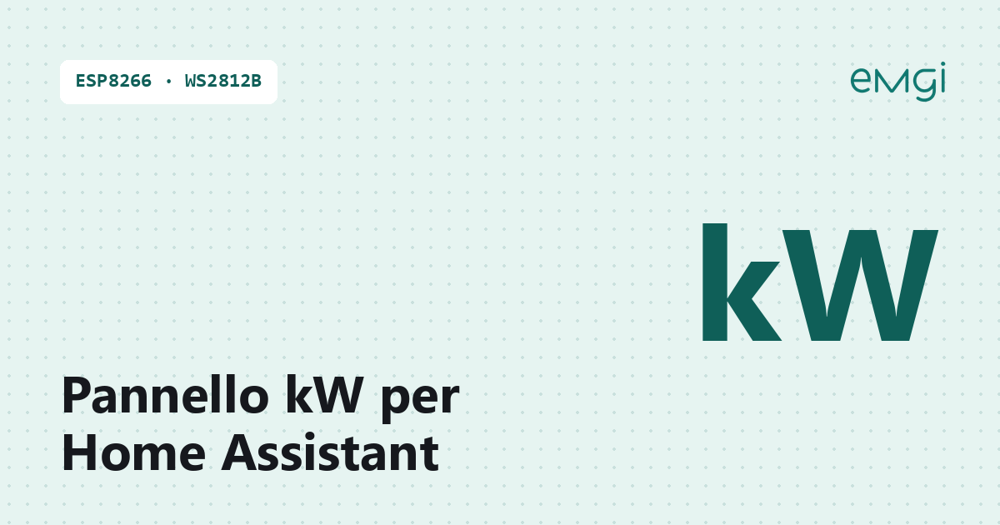

# Pannello kW con ESP8266, matrice WS2812B 8×32 e Home Assistant

> 📖 **Articolo completo con schema, foto e spiegazioni passo passo:**  
> **[Pannello kW con ESP8266, matrice WS2812B 8×32 e Home Assistant – www.emgi.it](https://www.emgi.it/2026/04/04/pannello-kw-con-esp8266-matrice-ws2812b-8x32-e-home-assistant/)**
>
> Altri progetti di elettronica, Arduino, ESP32, Home Assistant e stampa 3D su **[www.emgi.it](https://www.emgi.it)**

Questo progetto si integra in Home Assistant. Se non l’hai ancora installato, parti dalla guida [Come installare Home Assistant su Raspberry Pi 4, 5 e Zero](https://www.emgi.it/2026/04/14/installare-home-assistant-su-raspberry-pi/).

Volevo un indicatore semplice, immediato e sempre visibile per controllare il consumo elettrico istantaneo. Da qui nasce questo progetto: un pannello LED basato su **Wemos D1 mini** e una **matrice WS2812B 8×32**, che mostra in tempo reale i watt letti da **Home Assistant**.

## Cosa fa il progetto

Il pannello mostra il valore di un sensore di potenza già presente in Home Assistant direttamente su una matrice LED 8×32. Le funzioni principali della versione Arduino sono queste:

- lettura del sensore via **REST API** di Home Assistant, con intervallo configurabile
- visualizzazione del valore **in watt interi**, centrato automaticamente sulla matrice
- tre colori con soglie regolabili: colore basso, medio e alto
- **allarme sonoro non bloccante** sopra una soglia impostabile, con ripetizione a intervalli
- **interfaccia web** per modificare colori, soglie, luminosità, buzzer e parametri di Home Assistant senza ricompilare
- configurazione **persistente su LittleFS**, applicata a caldo senza riavvio
- doppio canale di aggiornamento **OTA**: porta di rete nell’IDE Arduino e pagina web di upload del file binario
- mDNS, quindi il pannello risponde a un nome di rete e non solo all’indirizzo IP
- ridisegno della matrice solo quando il valore cambia, per eliminare lo sfarfallio

## Componenti utilizzati

- Wemos D1 mini v4 oppure altra scheda ESP8266 compatibile
- matrice WS2812B 8×32 (256 LED)
- buzzer piezo **passivo**
- resistenza da 220–470 Ω in serie sul segnale dati, vicino al primo LED
- condensatore da 1000 µF tra 5V e GND, vicino alla matrice
- alimentatore 5V dedicato da almeno 2–3 A
- cavi Dupont per le prove o cablaggio definitivo saldato
- case stampato in 3D

## Collegamenti elettrici

Scheda: **Wemos D1 mini** (ESP8266). Pin verificati su sketch e YAML.

### Versione Arduino (`Pannello_Kw.ino`: `MATRIX_PIN 12`, `BUZZER_PIN 14`)

| Wemos D1 mini | Collegato a |
|---|---|
| **D6 / GPIO12** | **DIN** matrice WS2812B 8×32, con resistenza **220–470 Ω** in serie vicino al primo LED |
| **D5 / GPIO14** | **+** buzzer **passivo** |
| **GND** | − buzzer, GND matrice e GND alimentatore (massa comune) |
| **5V** | +5V alimentatore (oppure D1 mini alimentato da USB) |

| Alimentatore 5 V (2–3 A) | Matrice |
|---|---|
| +5V | 5V matrice |
| GND | GND matrice |

Condensatore da **1000 µF** tra 5V e GND vicino alla matrice. Mappatura: `NEO_MATRIX_TOP + LEFT + COLUMNS + ZIGZAG`.

### Versione ESPHome (`esphome/pannello_kw.yaml`)

| Wemos D1 mini | Collegato a |
|---|---|
| **RX / GPIO3** | **DIN** matrice (resistenza in serie) |
| **D5 / GPIO14** | **+** buzzer passivo |
| **GND** | − buzzer, GND matrice, GND alimentatore |

GPIO3 è la linea RX della seriale: per questo nel YAML il log seriale è disattivato (`baud_rate: 0`). Scollega il filo dati da RX se devi caricare il firmware via USB.

## Contenuto del repository

| Percorso | Descrizione |
|---|---|
| `Pannello_Kw/Pannello_Kw.ino` | Sketch Arduino |
| `esphome/pannello_kw.yaml` | Configurazione YAML |
| `immagini/` | Foto e immagini dell'articolo |

## Come si usa

1. **Versione Arduino:** apri [`Pannello_Kw/Pannello_Kw.ino`](Pannello_Kw/Pannello_Kw.ino), scheda **LOLIN(WEMOS) D1 R2 & mini**, Flash Size **4MB (FS:1MB OTA:~1019KB)**.
2. Inserisci SSID e password WiFi e **cambia le password OTA e /update** (`cambiami`).
3. Dalla pagina web del pannello inserisci indirizzo di Home Assistant, entità e Long-Lived Access Token.
4. **Versione ESPHome:** in alternativa usa [`esphome/pannello_kw.yaml`](esphome/pannello_kw.yaml).

Schema dei collegamenti, dettagli e risoluzione dei problemi: **[articolo su www.emgi.it](https://www.emgi.it/2026/04/04/pannello-kw-con-esp8266-matrice-ws2812b-8x32-e-home-assistant/)**.

## Licenza

- Codice e configurazioni: [MIT](LICENSE)
- Modelli 3D, schemi e immagini: [CC BY-SA 4.0](https://creativecommons.org/licenses/by-sa/4.0/deed.it)

---

**Autore:** Massimiliano Sandrin – **[eMGi.it](https://www.emgi.it)** · Domande e commenti sotto l'[articolo sul sito](https://www.emgi.it/2026/04/04/pannello-kw-con-esp8266-matrice-ws2812b-8x32-e-home-assistant/).
