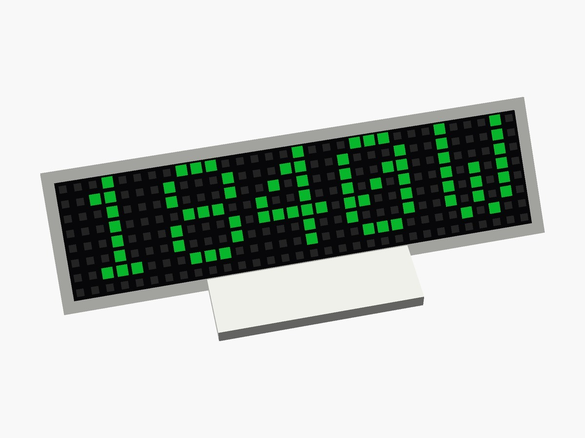

# kW power panel with ESP8266, WS2812B 8×32 matrix and Home Assistant

> 📖 **Full article with wiring diagram, photos and step-by-step explanations (in Italian):**  
> **[kW power panel with ESP8266, WS2812B 8×32 matrix and Home Assistant – www.emgi.it](https://www.emgi.it/2026/04/04/pannello-kw-con-esp8266-matrice-ws2812b-8x32-e-home-assistant/)**
>
> More electronics, Arduino, ESP32, Home Assistant and 3D printing projects at **[www.emgi.it](https://www.emgi.it)**

This project integrates with Home Assistant. If you have not installed it yet, start from the guide [How to install Home Assistant on Raspberry Pi 4, 5 and Zero](https://www.emgi.it/2026/04/14/installare-home-assistant-su-raspberry-pi/) (in Italian).

I wanted a simple, immediate and always-visible indicator of my home's instantaneous power consumption. That is how this project was born: an LED panel based on a **Wemos D1 mini** and a **WS2812B 8×32 matrix** that shows, in real time, the watts read from **Home Assistant**.

## What it does

The panel shows the value of a power sensor that already exists in Home Assistant directly on an 8×32 LED matrix. The main features of the Arduino version are:

- reads the sensor through the Home Assistant **REST API**, with a configurable interval
- shows the value **in whole watts**, automatically centred on the matrix
- three colours with adjustable thresholds: low, medium and high
- **non-blocking audible alarm** above a configurable threshold, repeated at intervals
- **web interface** to change colours, thresholds, brightness, buzzer, display orientation and Home Assistant parameters without recompiling
- configuration **stored on LittleFS** and applied on the fly without a restart
- two **OTA** update channels: network port in the Arduino IDE and a web page to upload the binary file
- mDNS, so the panel answers to a network name and not only to its IP address
- the matrix is redrawn only when the value changes, to avoid flicker

## Parts used

- Wemos D1 mini v4 or another compatible ESP8266 board
- WS2812B 8×32 matrix (256 LEDs)
- **passive** piezo buzzer
- 220–470 Ω resistor in series on the data line, close to the first LED
- 1000 µF capacitor between 5V and GND, close to the matrix
- dedicated 5 V power supply, at least 2–3 A
- Dupont wires for testing or soldered wiring for the final build
- 3D-printed case

## Wiring

Board: **Wemos D1 mini** (ESP8266). Pins checked against the sketch and the YAML.

### Arduino version (`kW_Power_Panel.ino`: `MATRIX_PIN 12`, `BUZZER_PIN 14`)

| Wemos D1 mini | Connected to |
|---|---|
| **D6 / GPIO12** | **DIN** of the WS2812B 8×32 matrix, with a **220–470 Ω** series resistor near the first LED |
| **D5 / GPIO14** | **passive** buzzer **+** |
| **GND** | buzzer −, matrix GND and power supply GND (common ground) |
| **5V** | power supply +5V (or D1 mini powered from USB) |

| 5 V power supply (2–3 A) | Matrix |
|---|---|
| +5V | matrix 5V |
| GND | matrix GND |

**1000 µF** capacitor between 5V and GND near the matrix. Mapping: `NEO_MATRIX_TOP + LEFT + COLUMNS + ZIGZAG`.

### ESPHome version (`esphome/kw_panel.yaml`)

| Wemos D1 mini | Connected to |
|---|---|
| **RX / GPIO3** | matrix **DIN** (series resistor) |
| **D5 / GPIO14** | passive buzzer **+** |
| **GND** | buzzer −, matrix GND, power supply GND |

GPIO3 is the serial RX line: this is why serial logging is disabled in the YAML (`baud_rate: 0`). Disconnect the data wire from RX if you need to upload the firmware over USB.

## Repository contents

| Path | Description |
|---|---|
| `kW_Power_Panel/kW_Power_Panel.ino` | Arduino sketch |
| `esphome/kw_panel.yaml` | ESPHome configuration (alternative version) |
| `images/` | Photos and images |

## How to use it

1. **Arduino version:** open [`kW_Power_Panel/kW_Power_Panel.ino`](kW_Power_Panel/kW_Power_Panel.ino), board **LOLIN(WEMOS) D1 R2 & mini**, Flash Size **4MB (FS:1MB OTA:~1019KB)**.
2. Enter your Wi-Fi SSID and password and **change the OTA and /update passwords** (`changeme`).
3. Open `http://kw-panel.local` and enter the Home Assistant address, the entity and a Long-Lived Access Token.
4. **ESPHome version:** alternatively use [`esphome/kw_panel.yaml`](esphome/kw_panel.yaml) — set your Wi-Fi, generate your API key and put your power sensor in `entity_id`.

Wiring diagram, details and troubleshooting: **[article on www.emgi.it](https://www.emgi.it/2026/04/04/pannello-kw-con-esp8266-matrice-ws2812b-8x32-e-home-assistant/)** (in Italian).

## License

- Code and configuration: [MIT](LICENSE)
- 3D models, diagrams and images: [CC BY-SA 4.0](https://creativecommons.org/licenses/by-sa/4.0/)

---

**Author:** Massimiliano Sandrin – **[eMGi.it](https://www.emgi.it)** · Questions and comments below the [article on the website](https://www.emgi.it/2026/04/04/pannello-kw-con-esp8266-matrice-ws2812b-8x32-e-home-assistant/).
